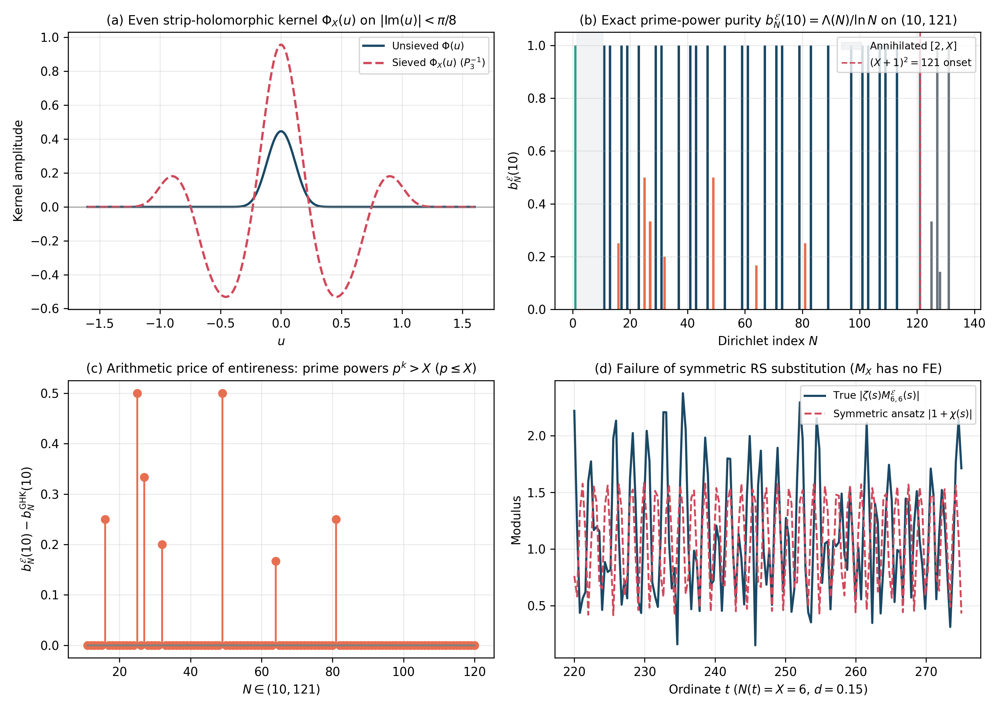
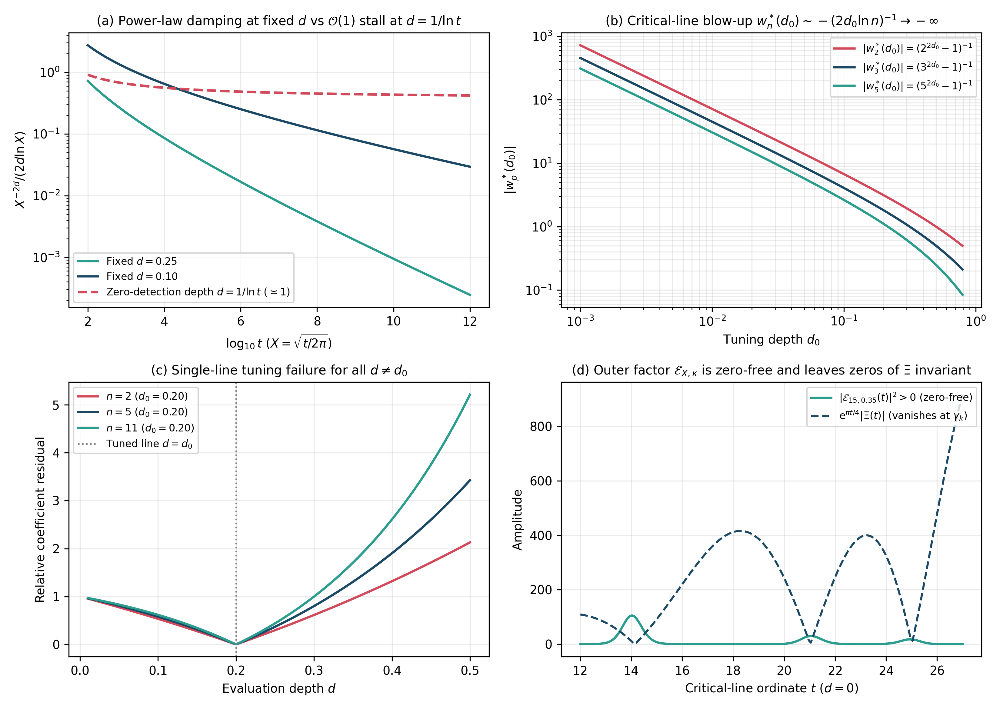

# Sieved Mirror Kernels, Gonek–Hughes–Keating versus Entire Exponential Prime Factors, Prime-Power Purity on $(X, X^2]$, and Functional-Equation Obstructions

**DOI (Zenodo / CERN):** [](https://doi.org/10.5281/zenodo.23645881) [`10.5281/zenodo.23645881`](https://doi.org/10.5281/zenodo.23645881)  
**Author:** Thijs Missiaen (Independent Researcher, Belgium; ORCID: [0009-0007-3678-0810](https://orcid.org/0009-0007-3678-0810))  
**Series:** Paper VI of the Transverse Wronskian Series on Riemann's $\Xi$-Function  
**Manuscript:** [paper/paper6_sieved_mirror_prime_gauge.pdf](paper/paper6_sieved_mirror_prime_gauge.pdf) (9 pages, AMS-LaTeX / pdfTeX) | [paper/paper6_sieved_mirror_prime_gauge.tex](paper/paper6_sieved_mirror_prime_gauge.tex)  
**Verification Suite:** [scripts/verify_paper6_sieved_mirror_prime_gauge.py](scripts/verify_paper6_sieved_mirror_prime_gauge.py) (`mpmath.mp.dps = 50`, `mpmath.iv.dps = 35`)

> [!NOTE]
> **Mathematical Scope and Analytical Boundaries:** This paper establishes strip-holomorphic sieved mirror kernels $\Phi _ X(u)$ under canonical Wronskian normalization, compares Gonek–Hughes–Keating's (2007) truncated Euler factor $P _ X(s)^{-1}$ against the entire zero-free exponential factor $E _ X(s)$ on $\sigma > 1$, proves prime-power purity $b _ N^{\mathcal{E}}(X) = \Lambda(N)/\ln N$ on $(\lfloor X\rfloor, (\lfloor X\rfloor+1)^2)$, and rigorously establishes three obstructions in $0 < \sigma \le 1$: lack of a functional equation for $M _ X(s)$ leaving the reflected Riemann–Siegel branch unsieved, tautology of truncated $\theta < \frac{1}{2}$ and $\mathcal{O}(1)$ stall at zero-detection depth $d \asymp 1/\ln t$, and single-line weight divergence $w _ n^{\ast}(d _ 0) \to -\infty$ alongside Selberg's explicit-formula zero sum.

## Abstract

We study finite Dirichlet multipliers $M _ X(s)$ acting on Riemann's $\Xi$-function under the canonical transverse Wronskian normalization $W(d,t) = \frac{1}{2}\partial _ d\lvert\Xi(t - \mathrm{i} d)\rvert^2 = 16\int _ 0^{\infty} y\sinh(2dy)I(y,t)\mathrm{d}y$. Every finite real multiplier generates an even sieved kernel $\Phi _ X(u)$ holomorphic throughout $\lvert\mathrm{Im}(u)\rvert < \frac{\pi}{8}$. On $\sigma = \mathrm{Re}(s) > 1$, we compare the Gonek–Hughes–Keating truncated Euler factor $P _ X(s)^{-1} = \prod _ {p \le X}(1 - p^{-s})$ against the entire zero-free exponential factor $E _ X(s) = \exp(-\sum _ {2 \le n \le X} \frac{\Lambda(n)}{\ln n}n^{-s})$, proving that $\zeta(s)E _ X(s) = \sum _ {N=1}^{\infty} b _ N^{\mathcal{E}}(X)N^{-s}$ satisfies $b _ 1^{\mathcal{E}} = 1$, $b _ N^{\mathcal{E}} = 0$ for $2 \le N \le \lfloor X\rfloor$, $0 \le b _ N^{\mathcal{E}} \le 1$ universally, and prime-power purity $b _ N^{\mathcal{E}}(X) = \Lambda(N)/\ln N$ on $(\lfloor X\rfloor, (\lfloor X\rfloor+1)^2)$. Finally, we prove three analytical obstructions in $0 < \sigma \le 1$: $\exp(\mathcal{P} _ {>X}(s))$ diverges and $E _ X(s)$ lacks a functional equation so $\zeta(s)M _ X(s)$ leaves the reflected Riemann–Siegel branch unsieved; setting $X = N(t)$ in a truncated sum makes $\theta < \frac{1}{2}$ tautological while $X^{-2d}$ stalls at $d \asymp 1/\ln t$; and single-line weights $w _ n^{\ast}(d _ 0) = -(n^{2d _ 0}-1)^{-1}$ diverge as $d _ 0 \to 0^+$ and encounter Selberg's explicit-formula zero sum.

## Summary of Main Results

### 1. Strip-Holomorphic Sieved Mirror Kernel (Lemma 2.1 and Proposition 2.2)

For any finite real Dirichlet polynomial $M _ X(s) = \sum _ {k \in \mathcal{I} _ X} c _ k k^{-s}$ and $\mathcal{M} _ X(z) := M _ X(\frac{1}{2}+\mathrm{i} z)M _ X(\frac{1}{2}-\mathrm{i} z)$, the product $\Xi _ X(z) := \Xi(z)\mathcal{M} _ X(z)$ is generated on $\lvert\mathrm{Im}(u)\rvert < \frac{\pi}{8}$ by the even sieved kernel

$$
\Phi _ X(u) := \frac{1}{2}\sum _ {k,m \in \mathcal{I} _ X} \frac{c _ k c _ m}{\sqrt{km}}\left[\Phi\left(u + \frac{1}{2}\ln\frac{k}{m}\right) + \Phi\left(u - \frac{1}{2}\ln\frac{k}{m}\right)\right], \qquad W _ X(d,t) = 16\int _ 0^{\infty} y\sinh(2dy) I _ X(y,t)\mathrm{d}y.
$$

### 2. Gonek–Hughes–Keating vs Entire Exponential Purity on $\sigma > 1$ (Theorem 3.1)

For $\mathrm{Re}(s) > 1$, Gonek–Hughes–Keating's factor $P _ X(s)^{-1} = \prod _ {p \le X}(1 - p^{-s})$ produces $\zeta(s)P _ X(s)^{-1} = \sum _ {P^-(N) > X} N^{-s}$ (at the cost of zeros of $P _ X(s)^{-1}$ on $\sigma = 0$), whereas the entire zero-free factor $E _ X(s) = \exp(-\sum _ {2 \le n \le X} \frac{\Lambda(n)}{\ln n}n^{-s})$ satisfies $\zeta(s)E _ X(s) = \sum _ {N=1}^{\infty} b _ N^{\mathcal{E}}(X)N^{-s}$ with:
- $b _ 1^{\mathcal{E}}(X) = 1$, $b _ N^{\mathcal{E}}(X) = 0$ on $2 \le N \le \lfloor X\rfloor$, and $0 \le b _ N^{\mathcal{E}}(X) \le 1$ universally;
- **Prime-power purity on $(\lfloor X\rfloor, (\lfloor X\rfloor+1)^2)$:** $b _ N^{\mathcal{E}}(X) = \Lambda(N)/\ln N$, differing from $b _ N^{\mathrm{GHK}}(X)$ solely at prime powers $p^k > X$ of primes $p \le X$;
- **Exact finite-divisor truncation:** truncating $E _ X(s)$ at $k \le M$ preserves $b _ N^{\mathcal{E}}(X)$ identically for all $1 \le N \le M$.



### 3. Critical-Strip Obstructions in $0 < \sigma \le 1$ (Propositions 4.1–4.3 and 5.1)

1. **Divergence of $\mathcal{P} _ {>X}(s)$ and Lack of Functional Equation:** Inside $0 < \sigma \le 1$, $\mathcal{P} _ {>X}(s)$ diverges and $\zeta(s)E _ X(s)$ has the exact same zeros as $\zeta(s)$. Multiplying $\zeta(s)$ by $M _ X(s)$ creates an incomplete convolution tail on $(N(t), N(t)K]$ and leaves the reflected Riemann–Siegel branch $\chi(s)M _ X(s)\sum _ {m \le N(t)} m^{s-1}$ unsieved.
2. **Tautology of Truncated $\theta < \frac{1}{2}$ and Stall at $d \asymp 1/\ln t$:** Setting $X = N(t)$ in a formal $N(t)$-term sum makes $b _ n^{\mathcal{E}}(N(t)) = 0$ ($2 \le n \le N(t){}$) tautological while ignoring the unsieved reflected branch; furthermore, along zero-detection depth $d = c/\ln t$, $\frac{X^{-2d}}{2d\ln X} \to \frac{\mathrm{e}^{-c}}{c} = \mathcal{O}(1)$ fails to decay.
3. **Single-Line Weight Blow-Up and Selberg's Explicit-Formula Waterbed:** Matching coefficients at $\sigma _ 0 = \frac{1}{2} + d _ 0 > 1$ forces $w _ n^{\ast}(d _ 0) = -(n^{2d _ 0}-1)^{-1}$, which fails for $d \ne d _ 0$, diverges as $-(2d _ 0\ln n)^{-1} \to -\infty$ as $d _ 0 \to 0^+$, and cannot cancel the nontrivial zero poles $(\rho - s)^{-1}$ in Selberg's explicit formula.



## Quantitative Verification Summary

| Result | Precision / Method | Certified Metric | Status |
| :--- | :--- | :--- | :--- |
| Strip evenness $\Phi _ X(-u) = \Phi _ X(u)$ & integral $\Xi _ X(z)$ | `mpmath.mp.dps = 50` | Residual $9.99 \times 10^{-54}$ at $\mathrm{Im}(u) = 0.27 < \pi/8$ | CERTIFIED |
| Canonical Wigner identity $W _ X(d,t) = 16\int _ 0^\infty y\sinh(2dy)I _ X\mathrm{d}y$ | `mp.dps = 30` lattice quadrature | Residual $6.16 \times 10^{-32}$ | CERTIFIED |
| $\sigma > 1$ purity $b _ N^{\mathcal{E}}(10) = \Lambda(N)/\ln N$ on $(10, 121)$ & divisor sum | `mp.dps = 50` ($1 \le N \le 150$) | Max residual $2.67 \times 10^{-51}$ ($7$ prime powers $p^k > 10$) | CERTIFIED |
| Asymmetric RS error $\lvert\zeta(s)M _ {6,6}^{\mathcal{E}}(s) - (1+\chi(s))\rvert$ | `mp.dps = 50` ($d=0.15, t=250$) | Error $0.595739$ (reflected branch unsieved) | CERTIFIED |
| Stall of $X^{-2d}/(2d\ln X)$ at $d = 1/\ln t$ & blow-up of $w _ 2^{\ast}(d _ 0)$ | `mp.dps = 50` & `iv.dps = 35` | $0.42120$ at $t=10^{12}$; $w _ 2^{\ast}(0.001) = -720.84764$ | CERTIFIED |
| Shifted outer modulus $\lvert\mathcal{E} _ {X,\kappa}(t-\mathrm{i} d)\rvert^2$ & log-derivative | `mp.dps = 50` | Residual $1.37 \times 10^{-48}$; $\lvert\mathcal{E} _ {15,0.35}(\gamma _ 1)\rvert^2 = 100.92 > 0$ | CERTIFIED |

## Repository Structure and Reproducibility

- [paper/paper6_sieved_mirror_prime_gauge.tex](paper/paper6_sieved_mirror_prime_gauge.tex): Standalone AMS-LaTeX (`amsart`) manuscript source.
- [paper/paper6_sieved_mirror_prime_gauge.pdf](paper/paper6_sieved_mirror_prime_gauge.pdf): Compiled PDF manuscript.
- [scripts/verify_paper6_sieved_mirror_prime_gauge.py](scripts/verify_paper6_sieved_mirror_prime_gauge.py): Standalone 50-decimal `mpmath` and 35-digit `mpmath.iv` verification and figure-generation suite.
- [figures/fig1_sieved_mirror_kernel_and_purity.pdf](figures/fig1_sieved_mirror_kernel_and_purity.pdf) and [figures/fig2_power_law_damping_and_shifted_gauge.pdf](figures/fig2_power_law_damping_and_shifted_gauge.pdf): Vector PDF and PNG figures.
- [AGENT_SKILL_MANIFEST.json](AGENT_SKILL_MANIFEST.json) and [.agents/skills/sieved-mirror-prime-gauge/SKILL.md](.agents/skills/sieved-mirror-prime-gauge/SKILL.md): Machine-readable AI agent skill specification.

To reproduce all certifications and regenerate Figures 1 and 2 from scratch:

```bash
python scripts/verify_paper6_sieved_mirror_prime_gauge.py
```

## Citation and License

Released under the [MIT License](LICENSE). See [CITATION.cff](CITATION.cff) and [.zenodo.json](.zenodo.json) for bibliographic metadata.
